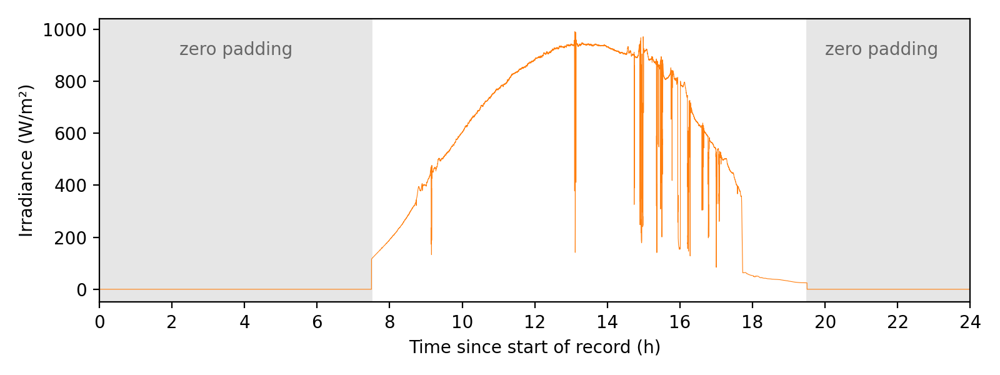

# One-second solar irradiance profile – UTFPR Pato Branco, Brazil

Solar irradiance profile with 1-second resolution (86,400 samples, 24 h), measured at the
Federal University of Technology – Paraná (UTFPR), Pato Branco campus, Brazil.
This dataset was used to evaluate the PV dispatch smoothing strategy (adaptive moving
average control and fuzzy energy management of a hybrid energy storage system).

## Files

| File | Description |
|------|-------------|
| `irradiance_profile.csv` | Irradiance profile (86,400 rows + header) |
| `irrProfile.mat` | Original MATLAB file (variable `qua`, 86400×1 double) |
| `irradiance_profile.png` | Plot of the profile |

## Data description

| Column | Unit | Description |
|--------|------|-------------|
| `time_s` | s | Time since the start of the record (0 to 86399) |
| `irradiance_W_m2` | W/m² | Solar irradiance |
| `measured` | – | `1` = measured sample; `0` = zero padding (not measured) |

- **Sampling period:** 1 s.
- **Measured interval:** samples 27000 to 70200 (12 h). Outside this interval the record
  was filled with zeros to complete a 24-h profile for the real-time simulations; these
  zeros are padding, not measurements, and are flagged with `measured = 0`.
- **Time reference:** the record starts at `time_s = 0`. The absolute date and the clock
  time corresponding to the first sample are not available.
- **Values** are reproduced exactly as stored in the original MATLAB file (6 decimal places).
  No gaps or negative values are present.

## Measurement site

- **Location:** UTFPR – Pato Branco campus, near the POLITEC building (block X1),
  Pato Branco, Paraná, Brazil.
- **Coordinates:** 26.19706° S, 52.68763° W (−26.19706, −52.68763; WGS84)
- **Sensor:** not documented.
- **Measurement date:** not documented.

## License

This dataset is released under the Creative Commons Attribution 4.0 International
license (CC BY 4.0). See `LICENSE`.

## How to cite

Please cite this dataset using the DOI provided by Zenodo (see the badge/record linked
to this repository) and the associated article.
